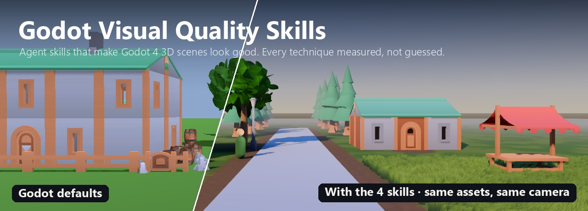
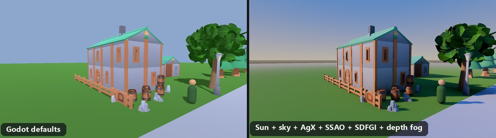
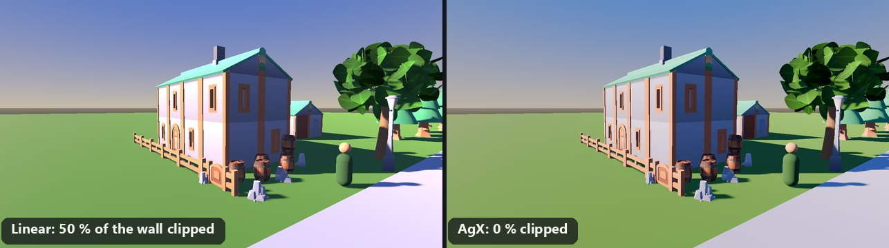
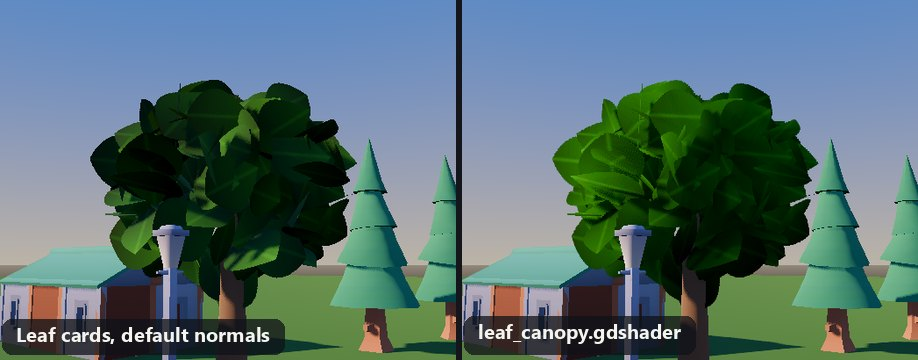
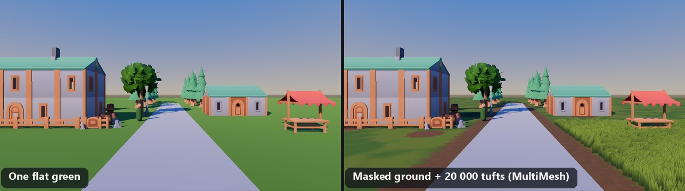
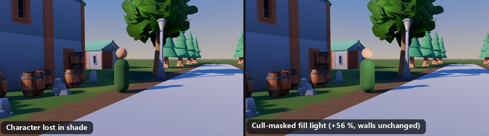
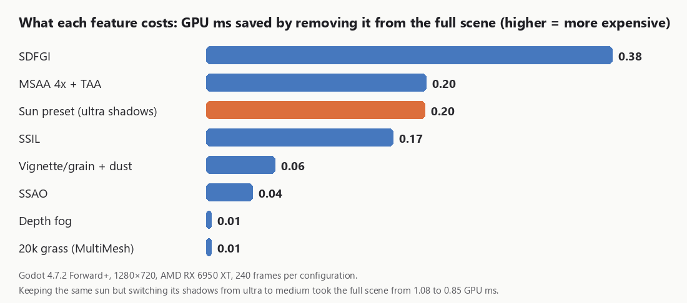

<p align="center">
  
</p>

<p align="center">
  
  
  
  
  
</p>

# Godot Visual Quality Skills

**Four agent skills that turn a flat, "default-looking" Godot 4 3D scene into a good-looking one, using only
engine settings, shaders and a few scripts. No new models, no new textures.**

A 3D game in Godot usually looks bad because of lighting and environment *decisions*, not because of an
engine limit or the assets. These skills teach a coding agent (Claude Code or any agent that reads `SKILL.md`
folders) what to change, in which order, and why. They also ship ready-to-use GDScript, shaders and Blender
scripts.

The method comes from the analysis of a video by Coding Quests ([credits](#credits)). Every technique was then
**reproduced and measured in a real Godot 4.7.2 scene** before being written down. Each skill keeps its
numbers in `references/evidence.md`.

## The skills

| Skill | Fixes | Ships |
|---|---|---|
| [`godot-lighting-environment`](skills/godot-lighting-environment/SKILL.md) | Flat buildings, black shadows, blown-out highlights, floating objects, no depth | `lighting_preset.gd`: sun → sky → AgX → SSAO/SSIL → SDFGI → depth fog, in that order |
| [`godot-vegetation-shaders`](skills/godot-vegetation-shaders/SKILL.md) | Blotchy leaf-card trees, grass that slides instead of bending, flat green ground, slow grass fields | `leaf_canopy`, `grass_wind` and `ground_blend` shaders, MultiMesh scatter, ground-mask builder, 2 Blender prep scripts |
| [`godot-lights-camera-post`](skills/godot-lights-camera-post/SKILL.md) | Character lost in shade, no local light, raw final image, jagged and shimmering edges | Cull-masked fill light, diegetic local lights, FOV/DOF framing, MSAA/TAA/alpha-to-coverage, vignette + grain shader, dust |
| [`godot-render-performance`](skills/godot-render-performance/SKILL.md) | "It looks great but runs at 50 fps" | GPU-time bench (each feature alone and leave-one-out), sun-shadow quality presets, a "lower the sub-setting, keep the look" method |

## Before / after

All images: Godot 4.7.2 Forward+, Kenney *Fantasy Town Kit* (CC0), same camera on both sides.

**Lighting: sun, sky, AgX, SSAO, SDFGI, depth fog.** The sun step alone takes the front/side wall luminance
ratio from 1.03 to 1.72. Shadows turn cool blue, the sun stays warm, and the background fades while the
foreground stays crisp.



**AgX tone mapping.** With an over-bright sun, Linear clips half of the sunlit wall to flat white; AgX clips
none of it.



**Leaf canopy shader.** Leaf normals point out of the canopy centre: one lit side and one shaded side instead
of random patches. Leaves are matte, with no sky sheen.



**Ground and grass.** A masked ground blend (worn dirt along paths, darker grass under trees) and 20,000 wind-
animated tufts drawn as one MultiMesh, with no grass shadows.



**Character fill light.** A small light restricted by `light_cull_mask` to the player's render layer makes the
character 56 % brighter in shade. The walls and road next to it don't change.



**Performance: measure, then lower the right sub-setting.** Leave-one-out GPU bench of the full scene. The sun
preset was one of the most expensive "features" because of the shadow settings bundled with it. Keeping the
same light with medium shadows cut the frame from 1.08 to 0.85 GPU ms, with a 0.2-0.5 % pixel difference.



## Install

The skills follow the Agent Skills layout (`SKILL.md` + optional `scripts/`, `assets/`, `references/`). Copy
the folders you want where your agent looks for skills.

Claude Code, for all your projects:

```bash
git clone https://github.com/laurentvv/godot-skill-quality.git
cp -r godot-skill-quality/skills/godot-* ~/.claude/skills/
```

Or for one Godot project only, into `<your-project>/.claude/skills/`. The agent loads a skill when your
request matches its description. No command is needed.

## Use

Just describe the problem. For example:

- *"My Godot village looks flat and washed out, fix the lighting in main.tscn."*
- *"My grass tufts slide on the ground when I animate them with sin(TIME)."*
- *"The player disappears in shaded streets but I don't want to brighten the level."*
- *"Should I turn off the sun's shadows to get my FPS back?"*

You can also use the shipped files directly, without an agent. For example:

```gdscript
const LightingPreset := preload("res://tools/lighting_preset.gd")

func _ready() -> void:
    LightingPreset.apply_sun($Sun)
    LightingPreset.apply_sky($WorldEnvironment.environment)
    LightingPreset.apply_tonemap($WorldEnvironment.environment)
```

## How it was validated

1. **Docs first.** Every Godot property, enum and project setting was checked against the class reference
   dumped from the Godot 4.7.2 binary and the `4.7-stable` docs. The Blender glTF exporter options were read
   from Blender 5.2 itself.
2. **Reproduce and measure.** A test village was built from Kenney assets, with a Blender-generated leaf-card
   tree and grass tufts. Each technique was rendered before and after from fixed cameras and measured on the
   pixels: wall luminance ratios, clipped-pixel share, contrast, Laplacian sharpness, root-vs-tip motion,
   frame-to-frame shimmer. Performance was measured as GPU time with vsync off.
3. **Evaluate the skills.** 8 realistic prompts were each run by an agent **with** and **without** the skill.
   Outputs were graded by compiling every produced `.gd`/`.gdshader` in Godot, loading the produced scenes
   and running the produced scripts on test nodes. Result: **58/58** checks with the skills, **55/58**
   without. A strong model already knows a lot about Godot. The skills add verified 4.7 API names, measured
   reference values, a consistent order of work and ready-to-use files.
4. **Iterate.** The eval runs surfaced real improvements, which were measured and folded back in:
   - wind weight that works with tinted vertex colours;
   - matte leaves without sky sheen;
   - foliage alpha-to-coverage;
   - "decide PCSS before shadow distance" (with PCSS on, a *shorter* shadow distance doubled the sun's cost);
   - MSAA × SDFGI/SSAO banding on flat ground (TAA alone was clean).

Absolute timings come from one GPU (AMD RX 6950 XT) and will differ on yours. The ratios and the method are
what carry over.

## Compatibility

- Godot **4.4+** (AgX tone mapping appeared in 4.4). Tested on **4.7.2** with the **Forward+** renderer.
- SSIL and SDFGI are Forward+ only. SSAO works in Forward+ and Compatibility. The skills say what to skip on
  Mobile/Compatibility.
- The Blender scripts run headless on Blender 4.2+ (tested on 5.2 LTS).

## Repository layout

```
skills/
  godot-lighting-environment/   SKILL.md, scripts/, references/ (settings, evidence), evals/
  godot-vegetation-shaders/     SKILL.md, assets/ (shaders), scripts/ (GDScript + Blender), references/, evals/
  godot-lights-camera-post/     SKILL.md, assets/, scripts/, references/, evals/
  godot-render-performance/     SKILL.md, scripts/, references/, evals/
docs/images/                    README illustrations (rendered from the test scene)
```

## Credits

- **Ideas and method**: *Why 3D Games Look Bad in Godot*, Coding Quests, 2026,
  <https://youtu.be/0792U-wuwjA>. This repository reuses the ideas (the 12 "graphics switches" and the
  performance method) with original wording, code and measurements. No text, code or images from the video
  are reproduced.
- **Test-scene assets in the images** (not redistributed in this repository):
  - [Kenney](https://kenney.nl) *Fantasy Town Kit* (CC0).
  - This work is based on "[wooden Barrel](https://sketchfab.com/3d-models/wooden-barrel-dc8560d9474e4293bc1452487495fd37)"
    by [jrybalov](https://sketchfab.com/jrybalov), licensed under
    [CC-BY-4.0](http://creativecommons.org/licenses/by/4.0/). It appears in the rendered images.
- **Engine**: [Godot Engine](https://godotengine.org) and its documentation.

Each skill has its own `PROVENANCE.md` with sources and the doc versions it was checked against.

## License

[MIT](LICENSE)
